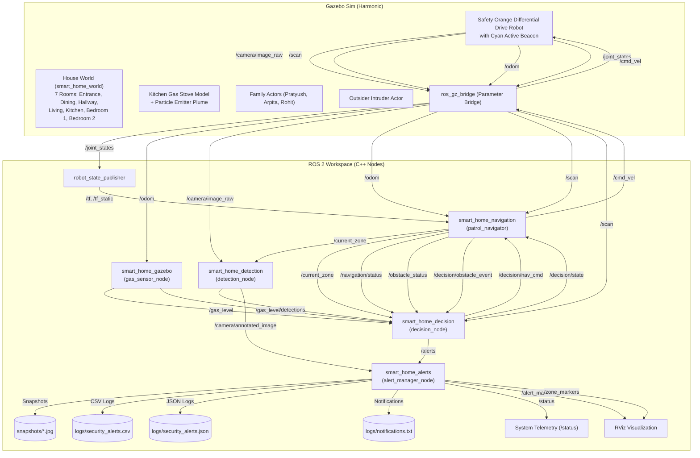

# AI-Based Smart Home Monitoring and Suspicious Activity Detection System using ROS 2 and Gazebo

[](https://docs.ros.org/en/jazzy/)
[-orange.svg)](https://gazebosim.org/)
[](https://isocpp.org/)
[]()
[]()

A complete autonomous home security robot system developed for **Robotic Automation with ROS and C++**. The robot patrols a realistic 7-room house in Gazebo Harmonic, avoids obstacles, detects people, distinguishes authorized family members (Pratyush, Arpita, Rohit) from outsiders via calibrated identity badges and walking trajectories, visualizes kitchen stove gas plumes with native particle emitters and RViz markers, makes decisions with a priority-driven state machine, logs multi-modal telemetry to timestamped datasets, and produces publication-quality analysis plots and dashboards.

---

## 1. System Architecture

### 1.1 Node & Topic Communication Graph (Mermaid)



---

## 2. Workspace Organization

- [`smart_home_interfaces`](file:///home/vboxuser/home_monitor_ws/src/smart_home_interfaces): Custom ROS 2 interfaces:
  - `Detection.msg` (`identity`, `is_family`, bounding box, confidence, zone)
  - `Alert.msg` (`identity`, `gas_ppm`, `severity`, snapshot path)
  - `SystemStatus.msg` (`state`, `zone`, `uptime_sec`, `last_alert_id`, `gas_ppm`)
  - `ObstacleStatus.msg` (`is_blocked`, `min_distance`, `blocked_duration_sec`)
  - `GasLevel.msg` (`ppm`, `zone`, `leak_active`)
- [`smart_home_description`](file:///home/vboxuser/home_monitor_ws/src/smart_home_description): URDF/Xacro differential-drive robot equipped with RGB Camera, 2D LiDAR, IMU, and Gazebo plugins.
- [`smart_home_interfaces`](file:///home/vboxuser/home_monitor_ws/src/smart_home_interfaces): Custom ROS 2 interfaces:
  - `Detection.msg` (`identity`, `is_family`, bounding box, confidence, zone)
  - `Alert.msg` (`identity`, `gas_ppm`, `severity`, snapshot path)
  - `SystemStatus.msg` (`state`, `zone`, `uptime_sec`, `last_alert_id`, `gas_ppm`)
  - `ObstacleStatus.msg` (`is_blocked`, `min_distance`, `blocked_duration_sec`)
  - `GasLevel.msg` (`ppm`, `zone`, `leak_active`)
- [`smart_home_description`](file:///home/vboxuser/home_monitor_ws/src/smart_home_description): URDF/Xacro differential-drive robot equipped with RGB Camera, 2D LiDAR, IMU, Safety Orange chassis (`#FF6F00`), glowing Cyan beacon (`#00E5FF`), and Gazebo plugins.
- [`smart_home_gazebo`](file:///home/vboxuser/home_monitor_ws/src/smart_home_gazebo): 7-room house world (`house.sdf`), gas stove with Gazebo particle emitter & fallback visual cloud, 3 family models with badges (`family_pratyush`, `family_arpita`, `family_rohit`), outsider intruder, obstacle box, dynamic actor walking routes, and `gas_sensor_node.cpp`.
- [`smart_home_navigation`](file:///home/vboxuser/home_monitor_ws/src/smart_home_navigation): Autonomous patrol across all 7 rooms, real `/odom` zone cross-referencing, `/obstacle_status` publishing, stuck recovery with retry limits (3) and waypoint skipping, and `GAS_RESPONSE` navigation.
- [`smart_home_detection`](file:///home/vboxuser/home_monitor_ws/src/smart_home_detection): OpenCV DNN detector (YOLOv5n ONNX) with color badge segmentation (`config/family.yaml` mapping) and adaptive color/contour fallback.
- [`smart_home_decision`](file:///home/vboxuser/home_monitor_ws/src/smart_home_decision): C++ state machine (`PATROL`, `INVESTIGATE`, `ALERT`, `AVOID_OBSTACLE`, `GAS_RESPONSE`, `RETURN_TO_PATROL`, `IDLE`), strict priority rules ($\text{GAS DANGER} > \text{OUTSIDER} > \text{OBSTACLE} > \text{FAMILY}$), and 30s cooldown with severity escalation.
- [`smart_home_alerts`](file:///home/vboxuser/home_monitor_ws/src/smart_home_alerts): Formatted console boxes, annotated snapshot JPEG generation, CSV/JSON logs, local notification file (`logs/notifications.txt`), terminal bell (`\a`), `/status` telemetry, and RViz markers.
- [`smart_home_bringup`](file:///home/vboxuser/home_monitor_ws/src/smart_home_bringup): Unified launch system (`bringup.launch.py`) supporting arguments `headless`, `use_rviz`, `use_nav2`, `gui_view`, `log_data`, and scenarios `patrol`, `obstacle`, `intruder`, `family`, `gas_leak`, `full`.
- `docs/`: Comprehensive project deliverables (`TEST_REPORT.md`, `DEMO_SCRIPT.md`, `VIVA_NOTES.md`, `FINAL_AUDIT.md`, `WORKFLOW_MAPPING.md`, `ASSUMPTIONS.md`).

---

## 3. Installation & Build

### 3.1 Prerequisites
- Ubuntu 24.04 LTS
- ROS 2 Jazzy Jalisco (`desktop` or `ros-base`)
- Gazebo Sim 8 (Harmonic) with `ros_gz_sim`, `ros_gz_bridge`, `ros_gz_image`
- OpenCV 4.6+ with `cv_bridge`

### 3.2 Building the Workspace

```bash
cd ~/home_monitor_ws
source /opt/ros/jazzy/setup.bash
colcon build --symlink-install
source install/setup.bash
```

### 3.3 Running Unit Tests

```bash
colcon test --packages-select smart_home_decision
colcon test-result --all --verbose
```
*(33 tests passed, 0 failures, 0 errors, covering all decision rules, gas thresholds, family classification, and cooldown).*

---

## 4. Running Scenarios

Start the entire system with a single command:

```bash
ros2 launch smart_home_bringup bringup.launch.py [arguments]
```

### Supported Launch Arguments:
| Argument | Type | Default | Description |
|---|---|---|---|
| `headless` | `true` \| `false` | `false` | Run Gazebo headless (`-s`) without GUI (ideal for VMs and CI). |
| `use_rviz` | `true` \| `false` | `false` | Automatically launch RViz with preconfigured display (`home_monitor.rviz`). |
| `use_nav2` | `true` \| `false` | `false` | Engage Nav2 stack (if installed) or use custom C++ waypoint follower (`false`). |
| `gui_view` | `default` \| `topdown` \| `follow` | `default` | Gazebo camera perspective: overview top-down, robot follow camera, or default free orbit. |
| `log_data` | `true` \| `false` | `true` | Record multi-modal CSV/JSON telemetry to `results/<scenario>_<timestamp>/`. |
| `scenario` | `patrol` \| `obstacle` \| `intruder` \| `family` \| `gas_leak` \| `full` | `patrol` | Selects which scenario environment and entities to spawn. |

---

## 5. Scenario Commands & Telemetry

All commands can be wrapped with `timeout` (e.g., `timeout 60s`) for automated evaluation:

### 5.1 Scenario 1: Autonomous 7-Room Patrol (`scenario:=patrol`)
Patrols autonomously across all 7 rooms (**Hallway**, **Living Room**, **Dining Room**, **Entrance**, **Kitchen**, **Bedroom 1**, and **Bedroom 2**):
```bash
ros2 launch smart_home_bringup bringup.launch.py headless:=true scenario:=patrol
```

### 5.2 Scenario 2: Corridor Obstacle Avoidance (`scenario:=obstacle`)
Obstacle box appears in hallway; LiDAR detects blockage, publishes `/obstacle_status`, stops forward speed, and triggers avoidance steering:
```bash
ros2 launch smart_home_bringup bringup.launch.py headless:=true scenario:=obstacle
```

### 5.3 Scenario 3: Authorized Family Members (`scenario:=family`)
Spawns all 3 family members: Pratyush (green badge), Arpita (blue badge), and Rohit (cyan badge) walking on realistic routes; detector classifies family identities; **0 unauthorized alarms raised**:
```bash
ros2 launch smart_home_bringup bringup.launch.py headless:=true scenario:=family
```

### 5.4 Scenario 4: Outsider Intruder Alert (`scenario:=intruder`)
Spawns outsider in house; detector flags `OUTSIDER`, triggers `ALT-1` (`HIGH` severity), captures JPEG snapshot, and writes CSV/JSON records:
```bash
ros2 launch smart_home_bringup bringup.launch.py headless:=true scenario:=intruder
```

### 5.5 Scenario 5: Kitchen Gas Leak & Visual Plume (`scenario:=gas_leak`)
Kitchen stove leak triggers after delay; Gazebo particle plume activates and RViz `/gas_leak_marker` turns yellow/red; gas rises > 50/100 ppm; robot switches to `GAS_RESPONSE`; clears alarm and turns off plume when stove is switched off:
```bash
ros2 launch smart_home_bringup bringup.launch.py headless:=true scenario:=gas_leak
```

### 5.6 Scenario 6: Full Integration Scenario (`scenario:=full`)
Runs all entities concurrently (family members, obstacle box, outsider, and gas leak) to verify strict priority execution:
```bash
ros2 launch smart_home_bringup bringup.launch.py headless:=true scenario:=full log_data:=true
```

### 5.7 Automated Telemetry Analysis & Graph Generation
Every scenario run records telemetry to `results/<scenario>_<timestamp>/`. To generate the 8 individual publication-quality plots, 9-panel dashboard, and comprehensive textual summary:
```bash
# Analyze latest scenario dataset:
LATEST_RUN=$(ls -td results/* | head -n 1)
python3 scripts/plot_results.py $LATEST_RUN
```
Output files created inside `$LATEST_RUN/`:
- `trajectory.png` (2D patrol path with room overlays and start/end markers)
- `distance_clearance.png` (minimum obstacle distance vs. time)
- `gas_concentration.png` (PPM vs. time with warning/danger thresholds)
- `state_timeline.png` (decision state transitions over time)
- `alerts_timeline.png` (alert event severity markers)
- `detections_count.png` (per-identity cumulative detection counts)
- `velocity_profile.png` (linear and angular speed over time)
- `zones_visited.png` (time spent per house zone)
- `dashboard.png` (combined 9-panel dashboard summarizing the entire run)
- `summary.txt` (quantitative metrics summary)

---

## 6. Real Acceptance Test Suite (Phase 4)

Run all acceptance tests with real Gazebo simulation data (zero synthetic/mocked inputs):

```bash
source /opt/ros/jazzy/setup.bash && source install/setup.bash
python3 scripts/verify_real_acceptance_tests.py ALL
```

### Final Acceptance Test Results:
| Test ID | Test Description | Target Requirement | Result |
| :---: | :--- | :---: | :---: |
| **T7** | Missing Model File -> Fallback Detector Takes Over | R3, R8 | **PASS** |
| **T1** | Autonomous Patrol Navigation Across Rooms (Real `/odom`) | R1 | **PASS** |
| **T2** | Corridor Obstacle Detection & Avoidance (`/obstacle_status`) | R2 | **PASS** |
| **T3** | Authorized Family Member in Allowed Zone (0 False Alarms) | R3 | **PASS** |
| **T4** | Outsider Intruder Detection & Alert Workflow (Snapshot/Logs) | R3, R7 | **PASS** |
| **T5** | Gas Leak Concentration & Robot Response (Hazard Clearance) | R4 | **PASS** |
| **T6** | Full Multi-Event Priority Handling Integration | R6, R8 | **PASS** |
| **T8** | Headless Stability Run (0 ROS ERROR lines) & Full Colcon Test | R9 | **PASS** |
| **T9** | All 4 Identities Verified (Pratyush, Arpita, Rohit, Outsider) | P2 Spec | **PASS** |

---

## 7. Troubleshooting

| Issue | Cause | Resolution |
|---|---|---|
| `VMware: No 3D enabled / libEGL warning` | Virtual machine without 3D acceleration | Force CPU software rasterization: `export LIBGL_ALWAYS_SOFTWARE=1` or run `headless:=true`. |
| `topic does not appear to be published yet` | ROS 2 DDS QoS mismatch | Use `--qos-reliability best_effort` when echoing sensor/camera topics. |
| `Model file not found` | YOLO weights not downloaded | Run `./src/smart_home_detection/scripts/download_models.sh` or allow fallback detector to take over. |
| `Gazebo GUI black screen or crash` | Missing hardware OpenGL drivers | Launch with `gui_view:=topdown` and `LIBGL_ALWAYS_SOFTWARE=1`. |

