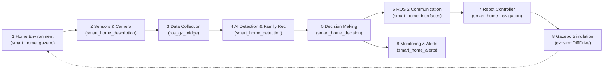
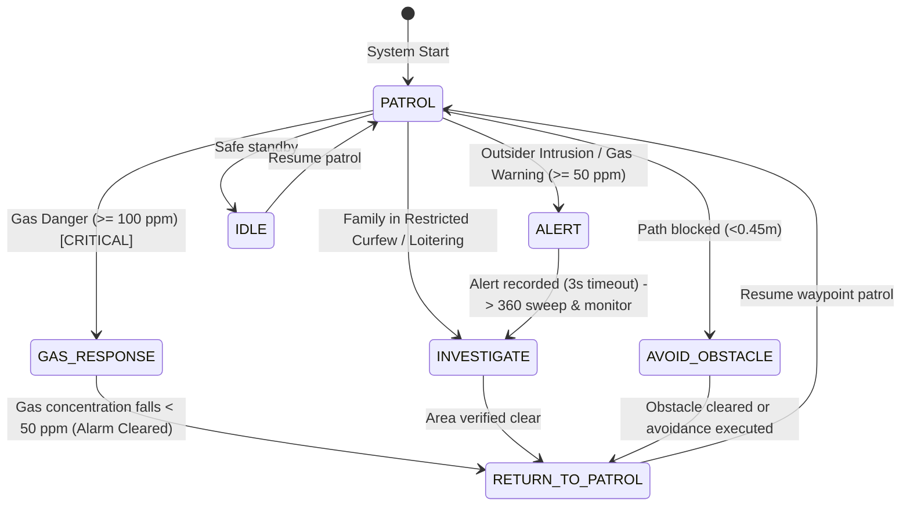

# Workflow Flowchart Implementation Mapping

This document provides a 1-to-1 traceability matrix mapping each block of the project's **Workflow Flowchart** and **Block Diagram** directly to the implementing C++ ROS 2 nodes, topics, source files, and Gazebo plugins.

---

## 1. Flowchart Traceability Matrix

| Flowchart Step | Block Name | Description | Implementing Node(s) | Topics Involved | Source File(s) |
|---|---|---|---|---|---|
| **START** | System Initialization | Launch simulation environment, spawn robot, start ROS-GZ bridges | `bringup.launch.py`, `ros_gz_sim`, `ros_gz_bridge` | `/clock`, `/parameter_events` | `smart_home_bringup/launch/bringup.launch.py` `smart_home_gazebo/worlds/house.sdf` |
| **1** | **Home Monitoring** | System monitors house environment across all 7 rooms (Living, Kitchen, Bedroom 1 [restricted], Bedroom 2, Entrance Foyer, Dining, Hallway) | `patrol_navigator`, `decision_node` | `/current_zone` `/navigation/status` `/status` | `smart_home_navigation/src/patrol_navigator.cpp` `smart_home_bringup/config/zones.yaml` |
| **2** | **Data Collection** | Camera, 2D LiDAR, Odometry, and Gas Sensor observe surroundings and stream raw data | Gazebo Harmonic Sensor plugins, `gas_sensor_node`, `parameter_bridge` | `/camera/image_raw` `/scan` `/odom` `/gas_level` | `smart_home_description/urdf/patrol_robot.urdf.xacro` `smart_home_gazebo/src/gas_sensor_node.cpp` `smart_home_gazebo/config/bridge_params.yaml` |
| **3** | **Data Processing** | Visual frames, laser scans, and gas ppm readings are converted (cv_bridge) and filtered | `detection_node`, `decision_node`, `patrol_navigator` | `/camera/image_raw` `/scan` `/gas_level` | `smart_home_detection/src/detection_node.cpp` `smart_home_navigation/src/patrol_navigator.cpp` |
| **4** | **AI Detection & Recognition** | Neural network (YOLOv5n ONNX) or adaptive fallback detects people and classifies FAMILY (identity badges) vs OUTSIDERS | `detection_node` | `/detections` `/camera/annotated_image` | `smart_home_detection/src/detection_node.cpp` `smart_home_interfaces/msg/Detection.msg` `smart_home_bringup/config/family.yaml` |
| **5** | **Decision Branch: Unusual Activity?** | C++ state machine evaluates detections, gas level, and LiDAR against rules with strict priority and 30s cooldown | `decision_node`, `smart_home::RuleEngine` | Evaluates `/detections`, `/gas_level`, `/scan`, `/current_zone` | `smart_home_decision/src/decision_node.cpp` `smart_home_decision/include/smart_home_decision/rule_engine.hpp` |
| **5A** | **YES: Anomaly Detected** | Gas danger leak, outsider intruder, corridor blockage, or restricted zone breach | `decision_node` | Transitions to `ALERT`, `INVESTIGATE`, `AVOID_OBSTACLE`, or `GAS_RESPONSE` | `smart_home_decision/src/decision_node.cpp` |
| **5B** | **NO: Normal Monitoring** | Path clear, authorized family member in allowed zone, safe gas level; continue surveillance | `decision_node` | Stays in `PATROL` state | `smart_home_decision/src/decision_node.cpp` |
| **6A** | **Alert Action** | Publish alert event, display console warning, record snapshot, write CSV/JSON logs, notify file, RViz markers | `alert_manager_node` | `/alerts` `/alert_markers` `/zone_markers` | `smart_home_alerts/src/alert_manager_node.cpp` `smart_home_interfaces/msg/Alert.msg` |
| **6B** | **Normal Action** | Log status (`🟢 [NORMAL MONITORING] Area: <zone> \| CLEAR`), log telemetry data on `/status` | `decision_node`, `alert_manager_node` | `/status`, console stdout | `smart_home_decision/src/decision_node.cpp` `smart_home_interfaces/msg/SystemStatus.msg` |
| **7** | **Robot Control** | Convert decision into robot actions (stop, reverse, steer, sweep, gradient follow) | `decision_node`, `patrol_navigator` | `/decision/nav_cmd` `/cmd_vel` | `smart_home_navigation/src/patrol_navigator.cpp` `smart_home_decision/src/decision_node.cpp` |
| **8** | **Gazebo Simulation** | Execute differential drive velocity commands in simulated physics safely | Gazebo Harmonic `DiffDrive` plugin | `/cmd_vel` (ROS) -> `/cmd_vel` (GZ) | `smart_home_description/urdf/patrol_robot.urdf.xacro` `smart_home_gazebo/worlds/house.sdf` |
| **9** | **Continuous Loop** | Robot completes reaction, returns to patrol, inspects continuously without supervision | Full pipeline orchestrated loop | Looping waypoint patrol & periodic timers | `smart_home_navigation/src/patrol_navigator.cpp` `smart_home_decision/src/decision_node.cpp` |

---

## 2. Block Diagram to Package Architecture Mapping

---

## 3. Decision Maker State Machine Mapping

